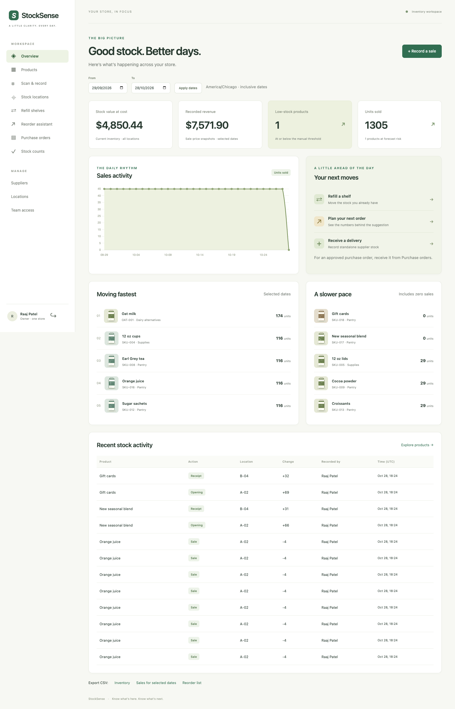
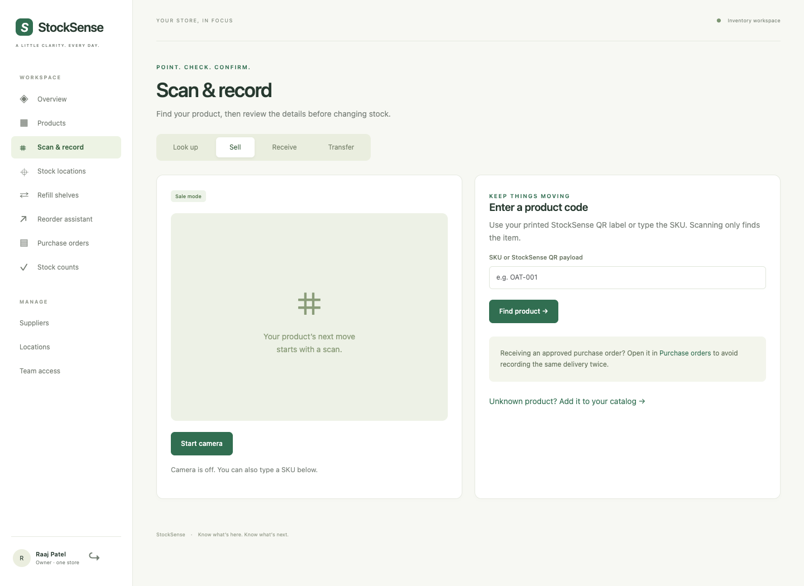

# StockSense — prototype MVP

A location-aware inventory and reorder assistant for a small café or shop. Built by Raaj Patel for Software Design I. Owners manage stock and suppliers; staff record sales, deliveries, transfers and physical counts. The reorder assistant explains its numbers using recent recorded sales.

## Run the local prototype

With [uv](https://docs.astral.sh/uv/getting-started/installation/) installed, run:

```sh
./scripts/run_mvp.sh
```

The launcher installs the locked environment, creates private demo credentials when `.env` is absent, migrates the database, seeds an empty database, checks stock reconciliation and opens a server at **http://127.0.0.1:5050**. Existing data and configuration are retained. For newly seeded accounts, read the owner/staff passwords from your local `.env` file (environment variables take precedence). Existing accounts keep their original passwords. Use `./scripts/run_mvp.sh --check` to prepare/check without starting a server, or `--port 5051` to choose another port.

This is the requested local prototype MVP. It runs without a hosting subscription. Paid Render deployment is a future release step; its prepared configuration is retained. See [MVP scope and handoff](docs/mvp-handoff.md).

## Features

- Whole-list receipt/email importing: photos, text/scanned PDFs, CSV, `.eml`, HTML and pasted text; editable supplier/product matching; review before receiving.
- Annual/cycle count sheets covering many products and locations, assignment, blind staff counts, saved progress, owner variance approval and recounts.
- Visual product cards, category navigation, status/location filters, sorting, compact table option and direct stock actions.
- Owner/staff sign-in, server-side permissions, store isolation and CSRF protection.
- Products, suppliers, prices, photos, descriptions, stable printable QR labels.
- Camera QR lookup with manual SKU fallback, explicit review and confirmation.
- Stock per shelf/backroom, atomic sales and receipts, transfers and movement history.
- Owner-approved stock corrections with stale-count detection.
- Shelf refill suggestions, separate from supplier purchasing.
- Explainable 14-completed-day reorder recommendations and approved incoming stock.
- Supplier drafts, editable quantities/destinations, approval, cancellation, full receipt once.
- Dashboard, dated sales chart, fastest/slowest products, owner-only cost metrics and CSV exports.
- Local browser assets: the demo works without a CDN or AI service.

## Quick start (macOS/Linux)

Install Python 3.12 and [uv](https://docs.astral.sh/uv/getting-started/installation/). Git is needed to clone the repository. PostgreSQL is optional for local use. Windows users can run through WSL; Gunicorn hosting is Linux.

```sh
git clone https://github.com/Raajp10/stocksense.git
cd stocksense
uv sync --frozen
cp .env.example .env
```

Edit `.env`: replace `SECRET_KEY` with a random value and set `DEMO_OWNER_PASSWORD` and `DEMO_STAFF_PASSWORD` to different passwords of at least 10 characters. Generate a key with `uv run python -c 'import secrets; print(secrets.token_hex(32))'`. Keep `.env` private.

```sh
uv run flask --app app db upgrade
uv run flask --app app seed-demo
uv run flask --app app reconcile
uv run flask --app app run --port 5050
```

Open **http://127.0.0.1:5050**. Sign in as `owner@stocksense.test` or `staff@stocksense.test` using the passwords you set. These are fictional local accounts. The seed includes a separate isolation-test owner (`other@stocksense.test`, same configured owner password); it has no access to the café. No passwords are shipped in the repository.

The seed creates 18 products, three suppliers, three stock locations, 30 days of synthetic sales, a shelf rule, a draft and an approved order. It refuses to overwrite existing stores. `--reference-date YYYY-MM-DD` creates repeatable history for a specified day; normal setup uses today's Chicago business date. For a fresh demo, use a new database path rather than deleting your data. See [demo script](docs/demo-script.md).

Without uv, create a Python 3.12 virtual environment and `pip install -r requirements.txt`, then invoke `flask` from that environment. Development checks use the locked uv environment.

## Import a receipt or supplier email

Open **Receive & import**. Prefer an original text PDF or CSV when available; for a paper slip upload a clear JPEG/PNG/WebP or use the phone photo picker. Photos and scanned PDFs use bundled RapidOCR PP-OCRv4 ONNX models on the CPU (about 15.4 MiB of model weights). Install the locked Python dependencies with `uv sync`; no separate OCR executable, cloud account or GPU is required. Spatial row/column reconstruction preserves invoice tables. Review all suggestions; mismatched line totals or document totals block finalization. Files stay local in the configured private upload directory.

The default **Receive & import** flow is now **upload → check items → add stock** for owners and workers. Correct product names, quantities and unit costs, confirm the delivery location once, then add the whole list. Supplier details stay saved from the bill; SKUs are generated for new products. No company/contact setup or selling-price entry is required to receive. Owners can open **More options** for the full review and purchase-order workflow. New products start without a selling price, display **Set selling price** to the owner, and cannot record sales until priced. Workers can access their own bill records; owners can review all store records.

Recognition supports common tabular and receipt layouts; it is not a guarantee that every unfamiliar layout, handwriting, currency or case-size convention is understood. Up to 10 MB, 5 PDF pages and 100 item lines per import. Non-USD costs require explicit conversion to the store's USD unit costs before confirmation. Supplier-reference and exact-document checks prevent common duplicate imports. Existing catalog prices/costs are retained; receipt costs stay on the document/order. An owner can explicitly update supplier contact details.

## Request a stock review

Open **Stock reviews**, select many products (optionally filtered by category), choose locations, assign a team member and set a purpose/due date. Every selected product/location pair becomes a count row, including zero-stock positions. Staff can save progress and submit the complete sheet; expected quantities are hidden by default. Owners see baseline, counted quantity, variance and current stock, then approve all corrections together or request a manual recount. An untouched sheet can refresh its baseline when physical counting starts. Movements after that baseline require a recount before approval. Review activity and previous observations are retained. Sheet CSV and print actions are included. Owners can cancel an unneeded open request without changing stock. Archived catalog records have owner-only Restore actions, and active count sheets must be resolved before their products or locations can be archived.

## Verification

```sh
uv run pytest --ignore=tests/e2e -q
uv run playwright install chromium
uv run pytest tests/e2e -q
uv run flask --app app db check
uv run flask --app app reconcile
```

Run PostgreSQL checks only against a **disposable dedicated test database**; the test fixture recreates its tables:

```sh
createdb stocksense_test
TEST_DATABASE_URL=postgresql+psycopg:///stocksense_test uv run pytest --ignore=tests/e2e -q
```

[Actual results](docs/test-results.md) distinguish automated scanner verification from physical camera testing. GitHub Actions runs SQLite, PostgreSQL and browser checks. [Architecture](docs/architecture.md), [requirements](docs/requirements.md), [decisions](docs/decisions.md) and [release checklist](docs/release-checklist.md) explain the design and remaining external checks.

## Interface

A green sidebar opens Overview, Products, Scan & record, Stock locations, Refill shelves, Reorder assistant, Purchase orders and Stock reviews. Owners also see supplier, location and team settings. Scan mode finds a product; the next form chooses units and locations; the confirmation page shows before/after quantities. Stock changes only after server confirmation.





## Inventory arithmetic

Product stock is the sum of location balances. A sale subtracts from the selected physical source; a transfer subtracts and adds the same units; a delivery adds to its destination. Every change and its ledger entry commit together. Reusing a submission token with the same request returns the original receipt; different payloads with that token are rejected.

Reorder uses the previous 14 completed business-calendar days, including zero-sales days and excluding today. A new product uses completed days since creation. The target is the greater of the manual threshold and `ceil(average daily sales × (lead time + safety days))`. Suggested units are `max(0, target − total stock − approved incoming units)`. The proposal fixture gives `84 / 14 × 5 − 8 = 22`. Draft orders do not count as incoming.

## Data and hosting

SQLite and uploads live in ignored `instance/` locally. Set `DATABASE_URL` for PostgreSQL and `UPLOAD_DIR` to durable storage in hosting. `render.yaml` describes a Render web service, PostgreSQL database, and persistent media disk, with deployment after CI checks pass. Provisioning these resources may cost money; see [deployment instructions](docs/deployment.md). Production requires `APP_ENV=production` and a random `SECRET_KEY`. Never expose Flask's debugger. Back up PostgreSQL and media together.

## Scope and limitations

One store per user, whole-number units, custom product-type QR codes, full order receipts, no payments, fractional weights, returns, recipes, lot/expiry automation, supplier API or manufacturer barcode lookup. Recorded sales can understate demand during stockouts. The formula is deterministic arithmetic, not learned forecasting. A new token for the same physical delivery cannot always be detected as a duplicate. AI Q&A, supplier email and PDF purchase orders remain optional future work.

Course deliverables include an executable application, public repository, a PDF report of at least 20 pages, and an in-class demonstration on December 9. Submission is December 13 by 11:59 p.m.; confirm the LMS timezone and demonstration timing. See [report](docs/StockSense_Report.pdf) and [AI disclosure](docs/ai-usage.md).

For an earlier incorrect receipt, open its record and choose **Re-read saved source with local ML**. This prepares a new editable draft without changing inventory. **Reverse incorrect receipt** previews the exact original movements and requires explicit confirmation; it appends compensating movements and preserves history. Receive a replacement only after the original receipt is reversed.

