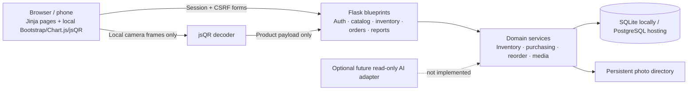
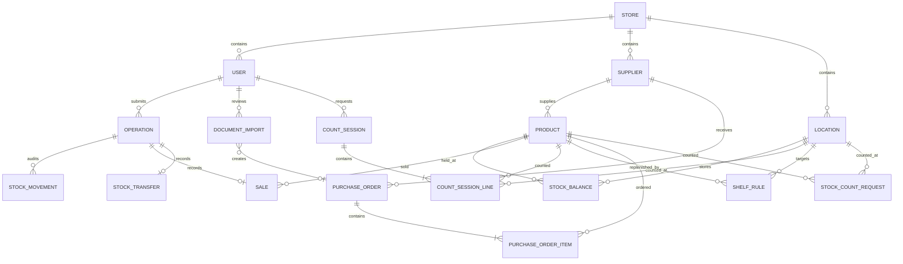

# Software design and architecture

StockSense is a server-rendered Flask monolith. The browser supplies form data and a CSRF token; Flask authenticates the session, checks the role and store, validates fields and calls domain services. Services execute stock rules inside SQLAlchemy transactions. Jinja templates render persisted outcomes. SQLite serves the classroom demo; PostgreSQL serves the hosting target. Money uses integer cents and inventory uses whole units. There is no AI dependency in the required release.



Figure 1: Runtime architecture. Thin HTTP adapters centralize authentication and presentation. Inventory and purchasing services enforce rules independently of camera/manual input. Camera frames remain in the browser. Media is a separate persistent directory because application files may be disposable during a hosted redeployment.



Figure 2: Entity relationship model. Every business table carries `store_id`; composite foreign keys require related records to belong to the same store. `StockBalance` is unique per product/location and nonnegative. Product total is calculated rather than separately updated. `Operation` has a unique store/token pair and a hash of the request, connecting an idempotency receipt to ledger entries. Sale prices and order costs are snapshots.

```mermaid
sequenceDiagram
 actor Staff
 participant Browser
 participant Flask
 participant Service
 participant Database
 Staff->>Browser: Scan QR / enter SKU
 Browser->>Flask: Resolve product within signed-in store
 Flask-->>Browser: Product, photo, location choices
 Staff->>Browser: Quantity and source, review, confirm
 Browser->>Flask: POST fields + CSRF + operation token
 Flask->>Service: execute(actor, sale, payload, token)
 Service->>Database: Lock store row; recheck account
 Service->>Database: Lookup token and request fingerprint
 alt Existing matching token
 Database-->>Service: Stored receipt
 else New action
 Service->>Database: Conditional decrement where sufficient
 Service->>Database: Insert sale + movement + operation receipt
 Service->>Database: COMMIT
 end
 Service-->>Browser: Server-confirmed result; refresh stock
```

Figure 3: Sale sequence. Recognition is read-only. The mutation occurs only after confirmation; retrying the same request cannot duplicate the effect. If any insert/update fails, rollback restores the balance and no partial sale is retained.

## Transactions and concurrency

All write paths acquire the store row by incrementing its revision before reading mutable state. PostgreSQL serializes writers for that store; SQLite serializes writers at database scope. After lock acquisition, the ORM expires cached records and re-reads current state. This conservative choice is appropriate for a small shop, but limits write throughput. It is easier to reason about than a partially ordered set of locks across product/location rows. Conditional decrements and database constraints remain a second defense.

Transfers append two linked movements and a transfer header in one transaction. Counts remember the observed balance version; approval refuses to overwrite intervening changes. Complete order receipt changes status and all line balances together. Purchase approval rechecks suggestions and approved incoming units to avoid duplicate purchasing.

## Time, media and boundaries

Business-calendar date filters are interpreted in the store's IANA timezone, converted to UTC half-open intervals, and displayed with their date range. Reorder excludes today's incomplete day. DST boundaries are covered by a 23-hour business-day test. Photos are decoded, pixel-limited, normalized to JPEG, stripped of metadata and stored under random names. Images never supply stock quantities or identity. QR payloads are allowlisted versioned tokens, not arbitrary navigable URLs.

## Receipt and review services

`document_reader.py` extracts text from emails/text PDFs/CSV, or rasterizes scanned PDF pages under a process-local PDFium mutex and uses CPU-only RapidOCR with bundled PP-OCRv4 ONNX weights, a process-local inference mutex, bounded image dimensions and spatial table reconstruction. Extracted text becomes suggestions, never inventory writes. `documents.py` validates every reviewed field, store-scoped match and destination. A reviewed document can create a draft purchase order, or use the inventory service's single `document_receipt` operation to commit all rows. Exact source hashes and supplier/reference keys reduce duplicates. Existing prices remain intact; explicit supplier contact updates are owner-controlled.

`stocktakes.py` stores an owner-requested sheet of product/location pairs. Its event count acts as a review revision to reject stale browser edits. Assignment and blind-count presentation are enforced server-side. Approval validates every balance version before any correction and commits the entire sheet through one inventory operation. Recounts preserve earlier observations while refreshing baseline versions. An untouched planned sheet can refresh its baseline before physical counting begins.

`quick_receive.py` builds the ordinary bill review from stored OCR metadata plus item corrections, generating missing SKUs and using one visible delivery destination. The owner-only advanced form remains available. Staff upload/review/source access is limited to their own document records; store scoping is retained. Quick posts ignore injected supplier-contact and selling-price fields. New products use a zero pending price; sale operations reject unpriced products, and the owner catalog exposes price setup. Existing price snapshots and existing catalog details are preserved. Money checks and the final inventory operation remain unchanged.
